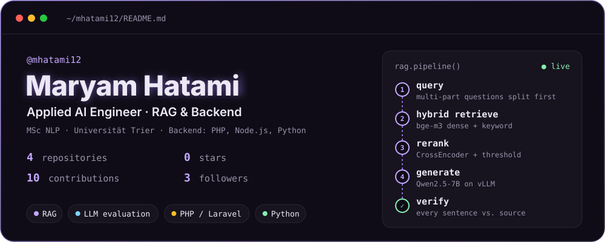
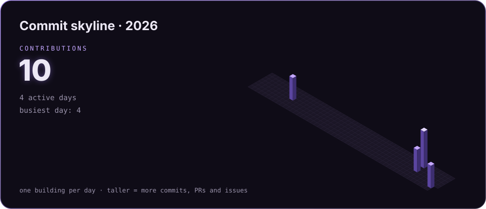
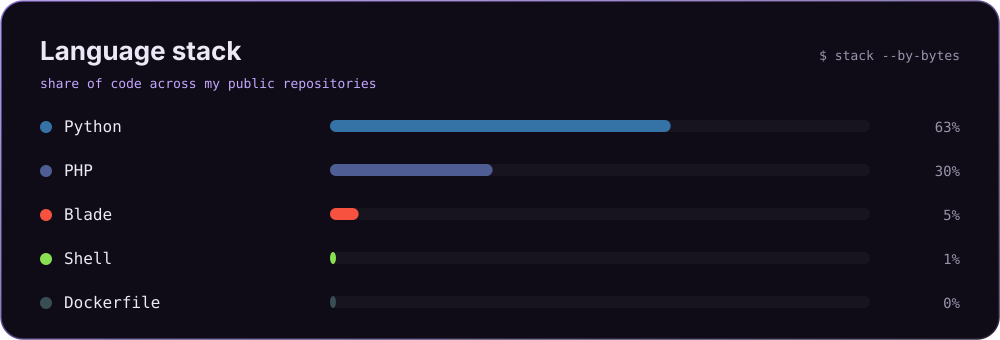

### About me

Applied AI Engineer, currently doing my **MSc in Natural Language Processing** at the University of Trier.
I build **retrieval-augmented generation** systems and LLM applications, from evaluation to deployment, on top of years of backend work with **PHP/Laravel, Node.js and Python**.

**Interests**
- Retrieval-Augmented Generation and LLM evaluation
- Agentic workflows and grounding checks for LLM outputs
- Backend architecture for AI systems in production

**Connect:** [LinkedIn](https://www.linkedin.com/in/maryam-hatamy)

The cards above rebuild daily from my GitHub activity with a small GitHub Action. Some university projects live on the university's internal GitLab and can't be shared publicly.
